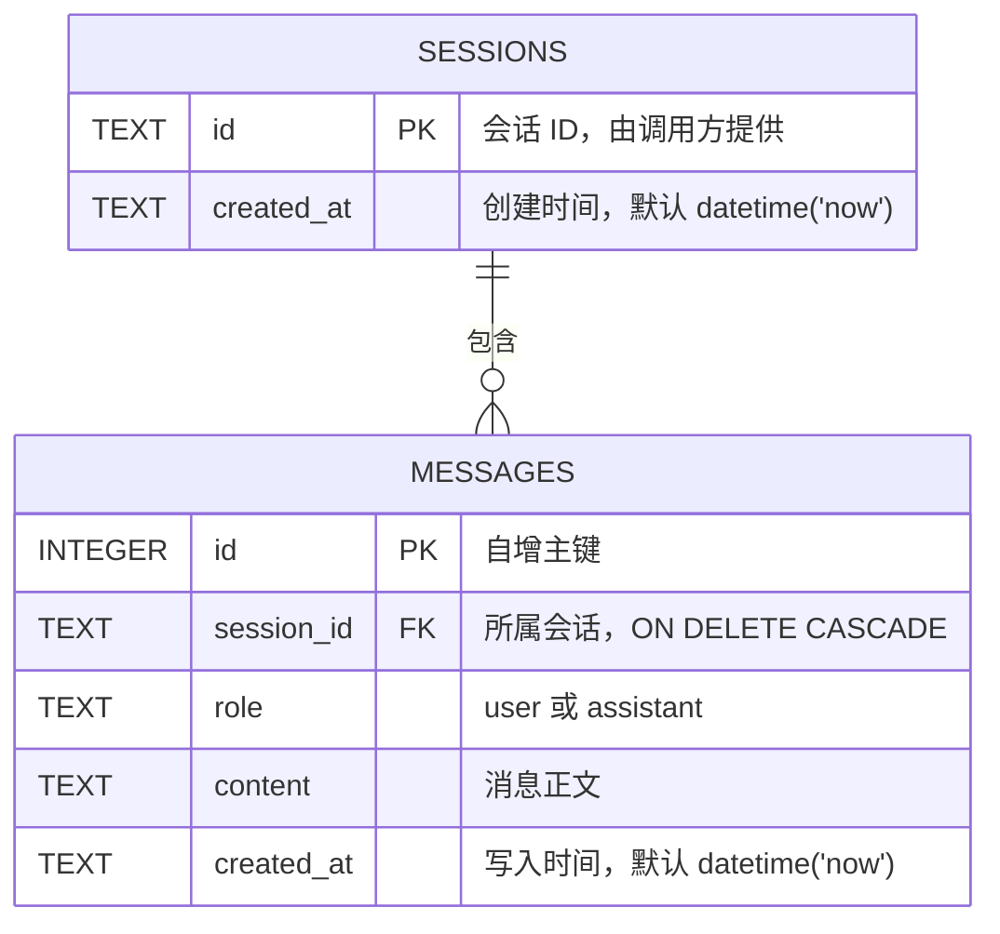

# 聊天机器人（命令行 + FastAPI 服务）

把命令行聊天机器人改造成 **FastAPI HTTP 服务**：调用方通过 `session_id`
发起连续对话，会话与消息保存在 **SQLite** 中，重启服务后历史仍然存在，
并提供会话列表 / 消息记录 / 清空接口。
原有的命令行入口 `chat.py` 仍然可用，两者共用同一套配置与模型调用封装。

## 功能

- **HTTP 对话**：`POST /chat`，同一 `session_id` 自动带上历史，不同会话互不串话。
- **流式输出**：`POST /chat/stream`，调用模型时 `stream=True`，用 `StreamingResponse`
  边生成边返回；结束后把完整回复写进历史。
- **SQLite 持久化**：会话与消息存在 `chat.db`（`sessions` + `messages` 两张表），
  服务重启后通过 API 查到的结果和重启前一致。
- **会话管理**：`GET /sessions`、`GET /sessions/{id}/messages`、`DELETE /sessions/{id}`。
- **网页界面**：`GET /` 返回 `static/index.html`（纯 HTML + CSS + 原生 JS），
  可新建 / 切换 / 删除会话，消息走 `/chat/stream` 逐块渲染。
- **学习功能**：`POST /study/word`，输入英文单词返回词性、释义和例句。
- **配置集中管理**：`config.py` + `pydantic-settings`，`.env` 覆盖，业务代码无硬编码；
  `api_key` 用 `SecretStr` 包装，接口响应里不会出现密钥。
- **错误处理**：空消息 422、不存在的会话 404、没配 Key 503、模型服务异常 502。
- **离线测试**：pytest + FastAPI `TestClient`，模型客户端用假对象注入，不联网。

## 快速开始

```bash
# 1. 安装依赖
pip install -r requirements.txt

# 2. 准备配置
cp .env.example .env          # Windows: copy .env.example .env
# 编辑 .env，至少填写 CHATBOT_API_KEY

# 3. 启动服务（监听地址与端口来自 config.py）
python -m app
# 或：uvicorn app.main:app --reload
```

启动后：

- 打开 <http://127.0.0.1:8000> 就是聊天页面（前端由后端托管）
- 打开 <http://127.0.0.1:8000/docs> 是自动生成的接口文档（Swagger UI）

Windows 也可以直接双击 `run_server.bat`。

首次启动会自动创建 `chat.db` 并建表（文件不存在时由 SQLite 创建）；
数据库文件已在 `.gitignore` 里，不会被提交。

命令行版本仍然可以运行：

```bash
python chat.py
```

## 接口一览

| 方法 | 路径 | 说明 |
| --- | --- | --- |
| `POST` | `/chat` | 普通对话，一次性返回完整回复 |
| `POST` | `/chat/stream` | 流式对话，逐块返回纯文本 |
| `GET` | `/sessions` | 查看所有会话 ID |
| `GET` | `/sessions/{session_id}/messages` | 查看某个会话的消息记录 |
| `DELETE` | `/sessions/{session_id}` | 清空某个会话 |
| `POST` | `/study/word` | 学习功能：单词讲解 |
| `GET` | `/health` | 健康检查（不调用模型） |

### 对话

```bash
curl -X POST http://127.0.0.1:8000/chat \
  -H "Content-Type: application/json" \
  -d '{"session_id":"u1","message":"你好，我叫小明"}'
```

```json
{"session_id": "u1", "reply": "你好，小明！有什么可以帮你的吗？"}
```

再问一轮，历史会自动带上：

```bash
curl -X POST http://127.0.0.1:8000/chat \
  -H "Content-Type: application/json" \
  -d '{"session_id":"u1","message":"我叫什么名字？"}'
```

### 会话管理

```bash
curl http://127.0.0.1:8000/sessions
# {"sessions": ["u1"]}

curl http://127.0.0.1:8000/sessions/u1/messages
# {"session_id":"u1","messages":[{"role":"user","content":"你好，我叫小明"},
#                               {"role":"assistant","content":"你好，小明！..."}]}

curl -X DELETE http://127.0.0.1:8000/sessions/u1
# 204 No Content；之后再查该会话返回 404
```

### 流式对话

请求体与 `/chat` 完全一样，响应是**逐块返回的纯文本**（不是 JSON），适合边收边显示：

```bash
curl -N -X POST http://127.0.0.1:8000/chat/stream \
  -H "Content-Type: application/json" \
  -d '{"session_id":"u1","message":"用三句话介绍 Python"}'
```

```text
Python 是一种简洁易读的编程语言。它常用于数据分析、Web 和人工智能。它的社区和第三方库非常丰富。
```

> 客户端断开时，已经生成的部分也会被保存到历史里。

### 学习功能：单词讲解

```bash
curl -X POST http://127.0.0.1:8000/study/word \
  -H "Content-Type: application/json" \
  -d '{"word":"resilient"}'
```

```json
{
  "word": "resilient",
  "explanation": "resilient：形容词，有韧性的、能迅速恢复的。例句：She stayed resilient after the setback. 她在挫折之后依然坚韧。"
}
```

这个接口独立于会话，不写入任何 `session_id` 的历史；提示词由
`CHATBOT_STUDY_SYSTEM_PROMPT` 配置，想换成「英语纠错」「学习小测」只要改提示词和请求字段。

## 网页界面

启动服务后访问 <http://127.0.0.1:8000>，看到的就是 `static/index.html`。
单文件、内联样式与脚本，没有引入 React / Vue 等任何 CDN 框架。

- 左侧会话栏：`GET /sessions` 拉列表，支持新建、切换、删除（`DELETE /sessions/{id}`）
- 右侧消息区：`GET /sessions/{id}/messages` 加载历史，发送后走 `POST /chat/stream` 逐块渲染
- 顶部「清空当前会话」：删除该会话的全部记录
- 新建会话在本地生成 `s-<时间戳>` 的 ID，发出第一条消息时由后端写入数据库

静态页面与 API 共用一个 FastAPI 应用：所有路由先注册，`StaticFiles` 最后挂到 `/`，
所以 `/chat`、`/sessions`、`/docs` 不会被静态目录「吞掉」。

### 错误约定

| 情况 | 状态码 |
| --- | --- |
| `message` 为空 / 全空白，或缺少字段 | `422` |
| `session_id` 为空 / 全空白 | `422` |
| `word` 为空 / 全空白 | `422` |
| 查询或删除不存在的会话 | `404` |
| 没有配置 `CHATBOT_API_KEY` | `503` |
| 模型服务连接失败 / 返回错误 | `502` |

## 数据库设计

会话数据存放在 SQLite 文件（默认 `chat.db`）里，由 `app/db.py` 在启动时自动建表。
拆成两张表，消息通过外键指向会话——没有把整轮对话序列化成 JSON 塞进单个字段。



对应的建表语句（与上图字段、类型、主外键一致）：

```sql
CREATE TABLE sessions (
    id         TEXT PRIMARY KEY,
    created_at TEXT NOT NULL DEFAULT (datetime('now'))
);

CREATE TABLE messages (
    id         INTEGER PRIMARY KEY AUTOINCREMENT,
    session_id TEXT NOT NULL REFERENCES sessions(id) ON DELETE CASCADE,
    role       TEXT NOT NULL CHECK (role IN ('user', 'assistant')),
    content    TEXT NOT NULL,
    created_at TEXT NOT NULL DEFAULT (datetime('now'))
);
```

- 删除会话时，`messages` 里的记录通过 `ON DELETE CASCADE` 一起删除。
- 读写全部集中在 `app/store.py`，路由层只调用 `append / append_turn / get / list_ids / delete`，
  以后换成 MySQL / PostgreSQL 不需要改路由。
- `*.db` 已写入 `.gitignore`，仓库里不保存数据库文件；测试用临时目录里的库。

## 配置项

全部配置位于 `config.py` 的 `Settings`，环境变量统一带 `CHATBOT_` 前缀。

| 环境变量 | 默认值 | 说明 |
| --- | --- | --- |
| `CHATBOT_API_KEY` | 无（必填） | API Key，`SecretStr` 存储 |
| `CHATBOT_BASE_URL` | `https://api.deepseek.com` | OpenAI 兼容接口地址 |
| `CHATBOT_MODEL` | `deepseek-chat` | 模型名称 |
| `CHATBOT_TEMPERATURE` | `0.7` | 采样温度，必须在 0~2 之间 |
| `CHATBOT_MAX_TOKENS` | 空 | 单次回复上限，空表示用服务端默认 |
| `CHATBOT_SYSTEM_PROMPT` | 内置提示词 | 助手人设 |
| `CHATBOT_STUDY_SYSTEM_PROMPT` | 内置提示词 | 学习功能（单词讲解）的提示词 |
| `CHATBOT_MAX_HISTORY_MESSAGES` | `20` | 发送给模型的最大条数（含 system） |
| `CHATBOT_STREAM` | `true` | 命令行模式是否流式输出 |
| `CHATBOT_REQUEST_TIMEOUT` | `60` | 请求超时（秒） |
| `CHATBOT_DB_PATH` | `chat.db` | SQLite 数据库文件路径 |
| `CHATBOT_SERVER_HOST` | `127.0.0.1` | HTTP 服务监听地址 |
| `CHATBOT_SERVER_PORT` | `8000` | HTTP 服务监听端口 |

优先级：环境变量 > `.env` > 字段默认值。

## 项目结构

```
chatbot/
├── app/                    # FastAPI 服务
│   ├── main.py             # create_app()：路由、异常处理、/health、静态页面挂载
│   ├── deps.py             # 依赖注入：配置 / 会话存储 / 模型客户端
│   ├── schemas.py          # 请求与响应模型（空消息在这里被拒绝）
│   ├── db.py               # SQLite 连接 + 建表语句（ER 图的来源）
│   ├── store.py            # SQLite 会话存储（路由只调用这里）
│   ├── service.py          # 业务逻辑：取历史 → 调模型 → 写历史
│   ├── routers/
│   │   ├── chat.py         # POST /chat、POST /chat/stream
│   │   ├── sessions.py     # 会话管理接口
│   │   └── study.py        # POST /study/word
│   └── __main__.py         # python -m app
├── config.py               # 配置模型 + get_settings()（lru_cache）
├── conversation.py         # system 消息、历史裁剪（CLI 与 API 共用）
├── llm.py                  # 构造客户端 / 发起请求 / 解析响应
├── chat.py                 # 命令行主循环
├── tests/
│   ├── conftest.py         # 隔离环境变量 + 假客户端与 app 夹具
│   ├── test_config.py      # 配置解析、越界校验、SecretStr 掩码
│   ├── test_llm.py         # mock client，断言传参
│   ├── test_api_chat.py    # 连续对话、会话隔离、空消息、单词讲解
│   ├── test_api_sessions.py# 会话列表、消息记录、清空、404
│   ├── test_api_stream.py  # stream=True、流式内容、流式后写入历史
│   └── test_db.py          # 建表、历史连续、隔离、级联删除、重开库仍在
├── static/
│   └── index.html          # 聊天页面（由后端挂载到 /）
├── docs/                   # 运行与测试证据
├── .env.example
├── .gitignore
├── pyproject.toml
├── requirements.txt
├── run.bat                 # 一键启动命令行版
└── run_server.bat          # 一键启动 API 服务
```

## 测试

测试完全离线，不需要真实 API Key，也不会发起网络请求：

```bash
pytest
```

| 文件 | 测什么 |
| --- | --- |
| `tests/test_config.py` | 默认值正确、环境变量覆盖、`CHATBOT_TEMPERATURE=5` 抛 `ValidationError`、`SecretStr` 不泄露明文 |
| `tests/test_llm.py` | mock client 后断言 `model` / `temperature` / `messages` / `stream=True` |
| `tests/test_api_chat.py` | 同一会话能连续对话、不同会话历史互不混用、空消息被拒绝、学习功能可调用 |
| `tests/test_api_sessions.py` | 能查看会话列表与消息记录、清空后不再返回、不存在的会话 404 |
| `tests/test_api_stream.py` | 模型收到 `stream=True`、流式内容正确返回、结束后完整写入历史 |
| `tests/test_db.py` | 建表成功、同一会话历史连续、不同会话隔离、删除会话后消息级联消失、重新打开数据库数据仍在 |
| `tests/test_api_web.py` | `GET /` 返回 index.html、页面不含 Key、挂载静态目录后 `/chat` 与 `/docs` 仍正常 |

## 设计说明

1. **为什么存储单独成 `app/store.py`**：路由层只调用存储接口，第三次作业把内存字典换成
   SQLite 时只改了这个文件；以后换 MySQL / PostgreSQL 同样不用动路由。
2. **为什么用 `create_app()` 工厂 + 依赖注入**：测试里传入假的 `Settings`、`SessionStore`、
   假客户端即可，完全不碰网络和真实 `.env`。
3. **为什么先调模型再写历史**：调用失败时不会在会话里留下「有提问没回答」的半截记录。
4. **为什么同步路由**：模型 SDK 是同步的，FastAPI 会把 `def` 路由放进线程池，不阻塞事件循环；
   线程安全由 `SessionStore` 内部的 `RLock` 保证。
5. **为什么一个连接 + 一把锁**：SQLite 的写操作本身就是串行的，FastAPI 的同步路由又在线程池里
   并发执行；单连接配 `RLock` 最简单，也兼容 `:memory:`。
6. **为什么启动时才建表**：建表放进 lifespan 而不是 import 阶段，`import app.main` 不会凭空
   生成 `chat.db`，测试也能用临时目录里的库。
7. **为什么流式接口先建流、再返回响应**：`create_completion` 放在 `StreamingResponse`
   之前调用，连接失败 / Key 无效还能返回正常的 502/503；放进生成器里，响应头已经发出，
   就只能断开连接了。
8. **流式为什么也能保存历史**：生成器用 `finally` 把已收到的分片拼起来写入，
   正常结束、模型报错、客户端断开三种情况都不会漏存。
9. **学习功能为什么不进会话**：`/study/word` 是独立的一问一答，写入会话反而会污染聊天上下文；
   需要多轮追问时，调用方可以改用 `/chat` 并自己拼提示词。
10. **为什么静态目录最后挂载**：Starlette 按注册顺序匹配，`app.mount("/")` 会兜住所有未命中的
    路径；放在路由之后，`/chat`、`/sessions` 先匹配，页面只在没有接口命中时兜底。

## 开发流程

仓库采用功能分支 + PR 的方式迭代，`main` 分支受保护：

- `feat/fastapi-chat-sessions`：FastAPI 骨架、对话接口、会话管理
- `feat/fastapi-stream-study`：流式输出、学习功能、流式测试
- `feat/db-persistence`：会话存储改为 SQLite + 数据库测试
- `feat/web-frontend`：聊天页面 + 静态托管 + 前端测试
- `main`：只通过 PR 合并

提交信息遵循 [Conventional Commits](https://www.conventionalcommits.org/)：

```
feat: 新增 FastAPI 对话接口
test: 新增会话管理离线测试
docs: 补充接口调用说明
```
